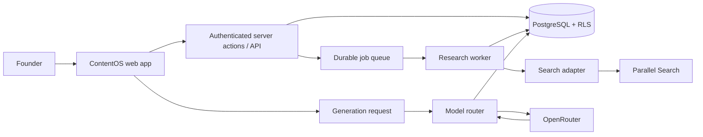

# ContentOS — Technical Product Documentation

**Version:** 1.0  
**Companion:** `PRD.md`  
**Status:** Build specification for closed beta

## 1. Architecture decision

ContentOS is a multi-tenant web application with an asynchronous research
pipeline. It must be built as a source-aware editorial workspace, not as a
long-running chat request.

### Locked beta stack

| Layer | Decision | Reason |
|---|---|---|
| Web | Next.js App Router + TypeScript | Server-rendered app, authenticated routes, API handlers |
| UI | Tailwind CSS + accessible component primitives | Fast, consistent application UI |
| Auth/data/storage | Supabase Auth, PostgreSQL, Storage | Tenant isolation, relational data, private uploads |
| Database access | Server-side typed query layer + SQL migrations | Explicit authorization and repeatable schema changes |
| Background work | Inngest or equivalent durable job platform | Retries, schedules, observability, idempotent research runs |
| Search | Parallel Search behind an internal adapter | Fast, cited public-web retrieval |
| Models | OpenRouter behind an internal model router | Configurable structured-output-capable models |
| Validation | Zod schemas at all trust boundaries | Reject malformed request/provider/model data |
| Monitoring | Structured logs, error tracking, job/usage metrics | Diagnose quality, cost, and provider failures |

Do not expose a provider key in browser code. Do not tightly couple business
logic to Parallel or OpenRouter response shapes.

## 2. Product boundary

The application owns editorial decisions and state. Providers only retrieve or
transform data.



## 3. Data model

Every tenant-owned table has `workspace_id`; all reads and writes verify the
authenticated user's membership on the server. RLS is defence in depth, not the
only authorization control.

### Core tables

| Table | Purpose | Important fields |
|---|---|---|
| `workspaces` | Tenant boundary | `id`, `name`, `owner_user_id`, `plan`, `created_at` |
| `workspace_members` | Roles | `workspace_id`, `user_id`, `role` |
| `brand_briefs` | Current editorial configuration | `workspace_id`, `audience`, `product`, `voice`, `restrictions`, `themes_json` |
| `memory_cards` | Founder-confirmed context | `kind`, `body`, `status`, `provenance_json`, `approved_at` |
| `research_runs` | One manual/scheduled brief | `status`, `trigger`, `idempotency_key`, `budget_snapshot`, `usage_json` |
| `source_results` | Normalised retrieval records | `canonical_url`, `title`, `excerpt`, `published_at`, `retrieved_at`, `content_hash` |
| `signal_cards` | Ranked research opportunities | `research_run_id`, `score_json`, `why_now`, `status`, `suppression_key` |
| `angles` | Founder-selected interpretations | `signal_card_id`, `body`, `origin`, `approved_by` |
| `content_assets` | Draft identity and lifecycle | `signal_card_id`, `platform`, `status`, `current_version` |
| `content_versions` | Immutable draft revisions | `content_asset_id`, `body`, `model_metadata_json`, `source_ids_json` |
| `claim_ledger_entries` | Reviewable claim boundaries | `content_version_id`, `claim`, `kind`, `source_ids_json`, `review_status` |
| `usage_events` | Provider and cost ledger | `workspace_id`, `run_id`, `provider`, `unit`, `quantity`, `estimated_cost` |
| `audit_events` | Security and editorial actions | `actor_user_id`, `action`, `resource_type`, `resource_id` |

`memory_cards.kind` is one of `fact`, `opinion`, `voice_example`, or
`candidate`. Only an `approved` card may be retrieved as authoritative founder
context. A candidate is never silently promoted.

### Essential constraints and indexes

- Unique `(workspace_id, idempotency_key)` on `research_runs`.
- Unique `(workspace_id, canonical_url)` on `source_results` where a canonical
  URL exists.
- Index `(workspace_id, status, created_at desc)` on drafts, runs, and signals.
- Append-only `content_versions` and `claim_ledger_entries`; corrections create
  a new record rather than overwriting history.
- Foreign-key every workspace-scoped child through its parent and validate
  workspace consistency in server code.

## 4. API surface

All routes require authentication. Resource IDs alone never grant access.

| Method and route | Purpose |
|---|---|
| `GET/PATCH /api/brand-brief` | Read/update the current Brand Brief |
| `GET/POST/PATCH /api/memory-cards` | Create, confirm, edit, archive memory |
| `POST /api/research-runs` | Create a manual run after quota check |
| `GET /api/research-runs/:id` | Safe status, progress, warnings, cost summary |
| `GET/PATCH /api/signals/:id` | Read/dismiss/save a Signal Card |
| `POST /api/signals/:id/angles` | Create/select a founder angle |
| `POST /api/content-assets` | Generate a draft from an approved angle |
| `GET/PATCH /api/content-assets/:id` | Read/edit/status transition of a draft |
| `GET /api/content-assets/:id/claims` | Claim Ledger for a selected version |
| `POST /api/content-assets/:id/versions` | Save a manual or generated revision |
| `GET /api/usage` | Limits, consumption, estimated spend |
| `DELETE /api/workspace-data` | Request data deletion according to retention policy |

Write endpoints use validated input schemas, CSRF protection appropriate to the
auth model, rate limits, audit events, and idempotency keys where a retry could
create paid work.

## 5. Research pipeline

### Job state machine

`queued → planning → retrieving → normalizing → deduplicating → scoring → succeeded`

Terminal alternatives are `partial`, `failed`, and `cancelled`. A partial result
is explicit; a failed provider call never produces invented research.

### Steps

1. Validate membership, workspace plan, remaining research budget, and themes.
2. Snapshot the Brand Brief and suppression settings into the run.
3. Create 2–4 bounded search objectives; do not let a model issue arbitrary
   fetches or change the user's topic policy.
4. Call the `ResearchProvider` interface. The first adapter calls Parallel
   Search; raw output is stored only as long as necessary for diagnostics.
5. Validate URLs, canonicalise conservatively, preserve retrieval date, and
   deduplicate exact URLs.
6. Score candidates with deterministic components plus a bounded model
   classification where needed: relevance, freshness, novelty, audience fit,
   evidence quality, and duplicate penalty.
7. Persist the component scores and plain-language explanation. Return no more
   than three signals in a beta brief.
8. Record provider usage even on partial failure, then finalize the job.

The score is a priority ranking. It must never be presented as a probability of
virality or a verified social trend.

## 6. Generation and Claim Ledger

### Context assembly

The generator receives only:

- the selected Signal Card and referenced source snippets;
- an explicit founder angle;
- a small set of approved Memory Cards and voice examples;
- format constraints for a LinkedIn text post;
- declared restricted topics and claims.

It does not receive all workspace documents, unreviewed candidate memories, or
unbounded search text. Keep source excerpts short and retain a source ID for
every excerpt placed in prompt context.

### Required structured output

Use a JSON schema such as:

```json
{
  "body": "LinkedIn draft",
  "claims": [
    {
      "text": "A factual or interpretive claim",
      "kind": "factual | opinion | unsupported",
      "source_ids": ["source_uuid"],
      "review_note": "Why the claim needs review, if applicable"
    }
  ],
  "quality_flags": ["optional flag"],
  "brand_fit_note": "brief explanation"
}
```

OpenRouter supports JSON-schema structured output on compatible models; still
validate the result with Zod before persisting it. See
[OpenRouter structured outputs](https://openrouter.ai/docs/guides/features/structured-outputs).

### Claim classification rules

- **Factual:** supported by one or more selected source records; show links.
- **Opinion:** a founder angle or interpretation; never present as externally
  verified fact.
- **Unsupported:** lacks evidence, overstates a source, invents an outcome, or
  conflicts with a restriction. Flag it for removal or founder rewrite.

No automated check can prove truth. The Claim Ledger improves review discipline;
it does not certify accuracy.

## 7. Provider interfaces and cost controls

```ts
interface ResearchProvider {
  search(input: SearchRequest): Promise<NormalizedSource[]>;
}

interface ModelProvider {
  generateDraft(input: DraftRequest): Promise<StructuredDraft>;
}
```

Keep adapters server-side. Parallel documents its Search API as synchronous web
retrieval, with published pricing that may change; OpenRouter bills per selected
model and provides routing/usage facilities. Recheck current terms before
launch. Sources: [Parallel documentation](https://docs.parallel.ai/introduction),
[OpenRouter pricing](https://openrouter.ai/pricing).

Controls required from the first deployment:

- Per-run maximum search queries, results, excerpt length, model tokens, and
  timeout.
- Per-workspace daily and monthly dollar caps enforced before each provider call.
- Usage events with provider, model, request ID, input/output units, and cost.
- Lower-cost model for classifications; quality model only for draft generation.
- Bounded retries for transient errors; no retry for invalid input or schema
  failure without a repair path.

## 8. Security, privacy, and reliability

- Use private storage and signed URLs for user uploads.
- Never render fetched HTML as trusted HTML; sanitise all user-facing text.
- Defend against SSRF with allowlisted protocols, URL validation, and no
  arbitrary server-side fetching requested by a model.
- Treat source text, uploads, and model output as untrusted. Prompt text cannot
  alter tool permissions, data access, or publishing policy.
- Store secrets only in server environment configuration; provide an
  `.env.example` with names but no values.
- Keep logs free of full prompts, source body text, API keys, and private brand
  material whenever possible.
- Apply RLS to workspace tables and integration-test cross-workspace denial.
- Define retention for source excerpts, raw provider payloads, uploads,
  embeddings, logs, and backups before public beta.

## 9. UI information architecture

### `/brief`

Default destination. Shows a manual-run button, latest three Signal Cards,
run state, and remaining allowance.

### `/signals/[id]`

Shows sources, dates, relevance explanation, Tension Map, dismissal reason, and
angle composer. It does not generate content until an angle exists.

### `/drafts/[id]`

Three-pane review: editor, Claim Ledger, and source links. The primary action is
approve/copy; publishing is deliberately absent from beta.

### `/memory`

Shows approved facts/opinions/voice examples separately from candidates, with
provenance and archive/delete controls.

### `/settings/brand` and `/settings/usage`

Brand Brief, themes, restrictions, quota, retention, and deletion controls.

Every async screen needs loading, empty, partial-success, exhausted-budget, and
safe-error states.

## 10. Test and evaluation plan

### Unit tests

- URL validation/canonicalisation and duplicate suppression.
- Score calculation and suppression-window logic.
- Content state transitions and workspace authorization.
- JSON-schema/Zod validation and claim-ledger classification.
- Quota/cost enforcement and idempotency.

### Integration tests

- Manual research run from request through persisted Signal Cards.
- Provider timeout, malformed response, rate limit, and partial result.
- Research-to-draft generation with a structured-output fixture.
- Cross-workspace access denial for sources, signals, drafts, and memory.
- Workspace deletion and retention cleanup.

### Product-quality evaluation

Maintain a small, permissioned evaluation set of brands, market themes, and
known source sets. Human reviewers score source relevance, citation alignment,
brand fit, originality, unsupported claims, and edit burden. Re-run the suite
whenever prompt templates or models change.

## 11. Build order

1. Auth, workspace membership, RLS, migrations, and Brand Brief.
2. Manual research run, provider adapter, durable job, sources, and Signal Card.
3. Tension Map and founder-angle selection.
4. Structured generation, Claim Ledger, versioned editor, and copy/export.
5. Quotas, usage ledger, observability, rate limits, and deletion controls.
6. Closed-beta evaluation and interviews.
7. Add scheduling only if users return for manual briefs; add second-channel
   adaptation only after LinkedIn draft approval is reliable.

## 12. Definition of done for beta

The beta is ready when a single founder can configure their brand, manually
produce a cited Signal Brief, turn an explicit angle into a LinkedIn draft,
inspect its Claim Ledger, edit/approve/copy it, and stay within a visible budget
without any cross-tenant access or public publishing capability.
